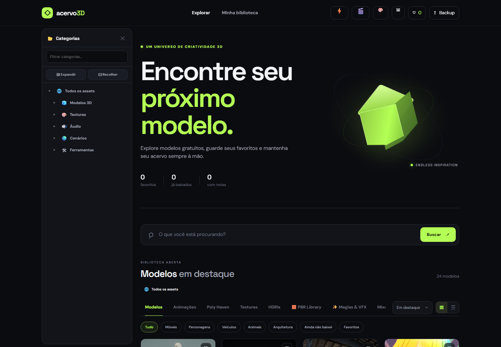
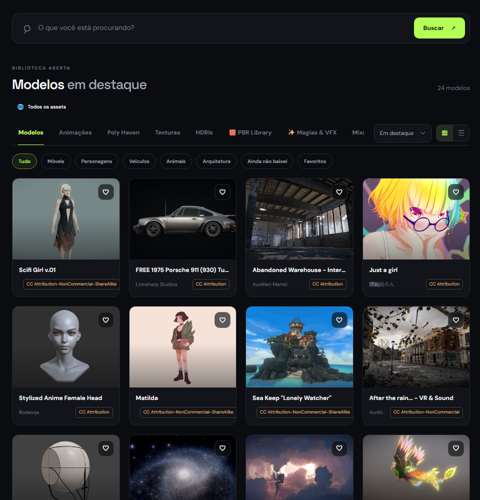
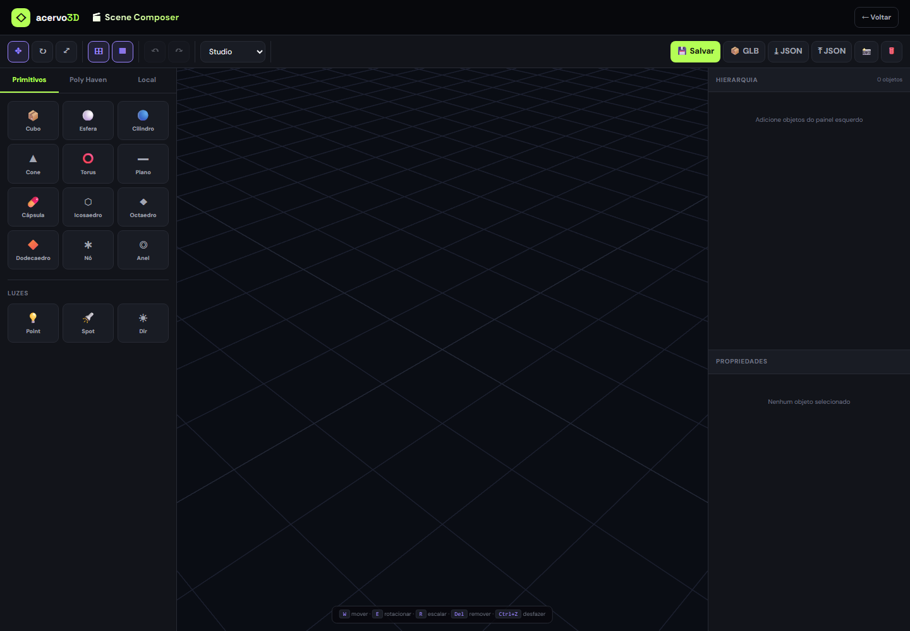
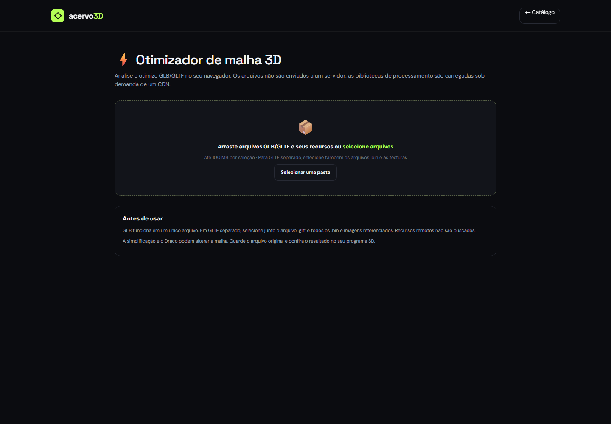

# Meu Acervo 3D

[Português](README.md) | [English](README.en.md)

**A catalog for discovering 3D models, textures, HDRIs, animations, and sounds, with built-in tools for creators.**

[](https://vercel.com)
[](LICENSE)
[](https://nodejs.org)
[](https://web.dev/progressive-web-apps/)

The site brings together sources such as Sketchfab, Poly Haven, ambientCG, Mixamo, Freesound, and Pixabay. You do not need to create an account to use Meu Acervo 3D. Availability, API key requirements, and licenses vary by source and asset.

## Screenshots

### Home page


### Model catalog


### Scene Composer


### Optimizer


## Features

- **Unified catalog:** search downloadable Sketchfab models, as well as models, PBR materials, and HDRIs from sources such as Poly Haven and ambientCG.
- **3D tools:** Scene Composer, GLB/GLTF file optimizer, PBR editor, and batch optimizer.
- **Game development:** Mixamo animations, humanoids, animated creatures, visual effects, and scene kits.
- **Audio:** curated library with optional searches on Freesound and Pixabay.
- **Blender add-on:** search for assets from the sidebar and import glTF models from Poly Haven.
- **Personal library:** favorites, history, notes, ratings, and backups stored in your browser.
- **PWA:** responsive interface with basic offline caching support.

Personal library data stays in your browser's local storage. Searches may send queries to the selected external service. Check the source page for terms and licensing before using or redistributing an asset.

## Run locally

Requires Node.js 18 or later and npm. From the project directory, install the dependencies and start the server:

```bash
npm install
npm start
```

Open the address shown in the terminal (usually `http://localhost:3000`). Do not open `public/index.html` directly: the site needs the local server to load its files and APIs.

### Platform shortcuts

- **Windows:** run `INICIAR-SITE.bat`; it installs the required dependencies on first launch, starts the server, and opens the site.
- **macOS/Linux:** run `sh ./INICIAR-SITE.sh`, or use `npm install` and `npm start` in the terminal.

If port 3000 is already in use on macOS/Linux, start the app on another port, for example: `PORT=3001 npm start`.

## Environment variables (optional)

Freesound and Pixabay searches require API keys. Other features and the local curated content remain available without them.

1. Copy `.env.example` to `.env`.
2. Set `FREESOUND_API_KEY` and/or `PIXABAY_API_KEY`.
3. Restart the server.

The `.env` file is local and must not be committed to Git. For a Vercel deployment, configure the keys in the project’s environment variables. Never put API keys in files under `public/`.

## Deployment

The project can be deployed to Vercel:

```bash
npm install --global vercel
vercel
```

Configure the required environment variables in the Vercel dashboard before enabling searches that depend on API keys.

## License

The project code is licensed under the MIT License; see [LICENSE](LICENSE). Models, textures, sounds, and other third-party content remain subject to the licenses of their original sources.
