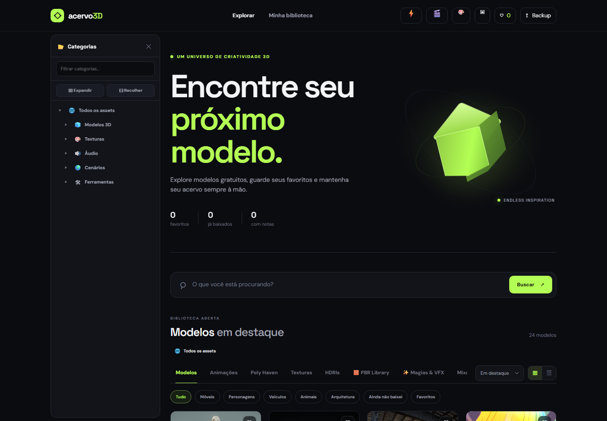
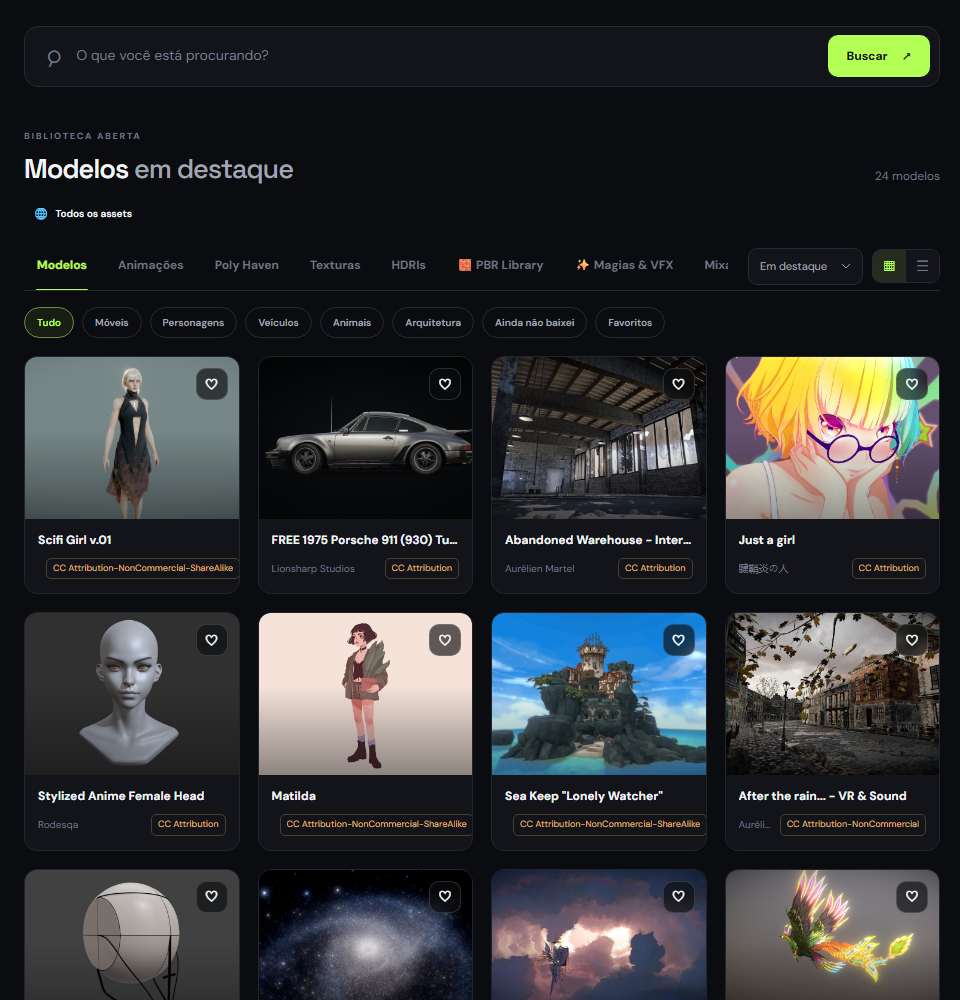
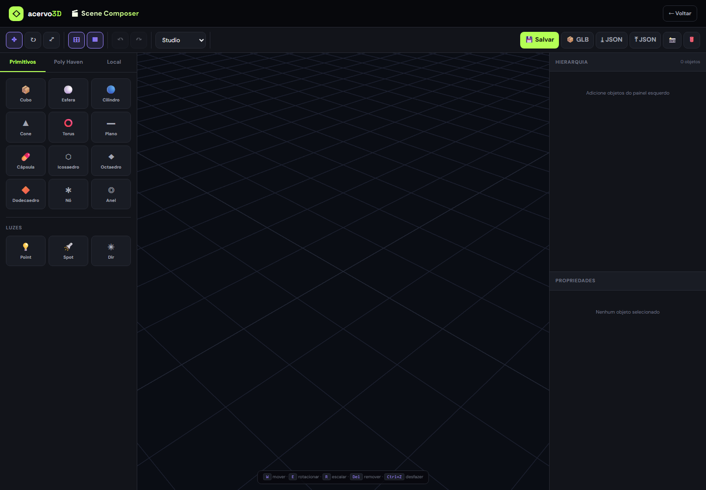
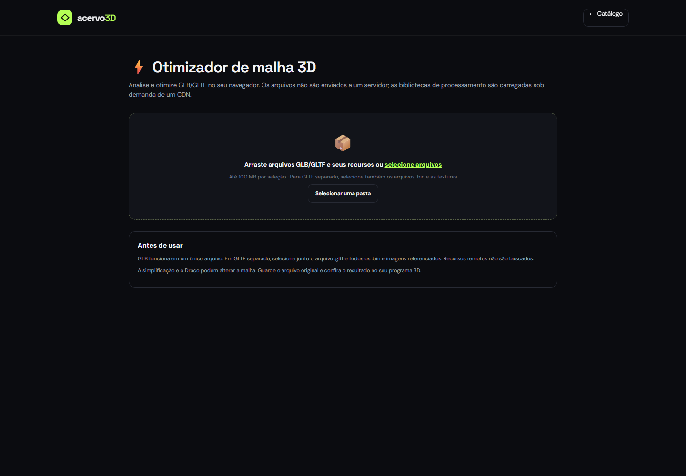

# Meu Acervo 3D

**Um catálogo para descobrir modelos 3D, texturas, HDRIs, animações e sons, com ferramentas integradas para criação.**

[](https://vercel.com)
[](LICENSE)
[](https://nodejs.org)
[](https://web.dev/progressive-web-apps/)

O site reúne fontes como Sketchfab, Poly Haven, ambientCG, Mixamo, Freesound e Pixabay. Não é necessário criar uma conta no Meu Acervo 3D. A disponibilidade, a necessidade de chaves de API e as licenças variam conforme cada fonte e asset.

## Screenshots

### Página inicial


### Catálogo de modelos


### Scene Composer


### Otimizador


## Recursos

- **Catálogo unificado:** busca modelos baixáveis do Sketchfab, além de modelos, materiais PBR e HDRIs de fontes como Poly Haven e ambientCG.
- **Ferramentas 3D:** Scene Composer, otimizador de arquivos GLB/GLTF, editor PBR e otimizador em lote.
- **Game development:** animações Mixamo, humanoides, criaturas animadas, efeitos visuais e kits de cenários.
- **Áudio:** biblioteca curada com buscas opcionais em Freesound e Pixabay.
- **Blender Add-on:** pesquise assets pelo painel lateral e importe modelos glTF do Poly Haven.
- **Acervo pessoal:** favoritos, histórico, notas, avaliações e backups no navegador.
- **PWA:** interface responsiva e suporte básico a cache offline.

Os dados do acervo pessoal ficam no armazenamento local do navegador. As buscas podem enviar consultas ao serviço externo escolhido. Confira os termos e a licença na página de origem antes de usar ou redistribuir um asset.

## Rodar localmente

Requer Node.js 18 ou superior e npm. Na pasta do projeto, instale as dependências e inicie o servidor:

```bash
npm install
npm start
```

Abra o endereço exibido no terminal (normalmente `http://localhost:3000`). Não abra `public/index.html` diretamente: o site precisa do servidor local para carregar seus arquivos e APIs.

### Atalhos por sistema operacional

- **Windows:** execute `INICIAR-SITE.bat`; ele instala as dependências necessárias na primeira execução, inicia o servidor e abre o site.
- **macOS/Linux:** execute `sh ./INICIAR-SITE.sh` ou use `npm install` e `npm start` no terminal.

Se a porta 3000 estiver ocupada no macOS/Linux, inicie em outra porta, por exemplo: `PORT=3001 npm start`.

## Variáveis de ambiente (opcional)

As buscas em Freesound e Pixabay requerem chaves de API. Sem elas, as demais funções e a curadoria local continuam disponíveis.

1. Copie `.env.example` para `.env`.
2. Preencha `FREESOUND_API_KEY` e/ou `PIXABAY_API_KEY`.
3. Reinicie o servidor.

O arquivo `.env` é local e não deve ser enviado ao Git. No deploy da Vercel, configure as chaves nas variáveis de ambiente do projeto. Nunca coloque chaves nos arquivos dentro de `public/`.

## Deploy

O projeto pode ser publicado na Vercel:

```bash
npm install --global vercel
vercel
```

Configure as variáveis de ambiente necessárias no painel da Vercel antes de habilitar as buscas que dependem de chaves.

## Licença

O código do projeto está sob a licença MIT; consulte [LICENSE](LICENSE). Modelos, texturas, sons e outros conteúdos de terceiros continuam sujeitos às licenças de suas fontes originais.
